# ai-governance-gate

**CI/CD gates that make an LLM feature prove it is registered, safe and documented before it ships — and emit the evidence an assessor needs.**

The same idea as DevSecOps gates (SAST, image scanning, signing), applied to models, prompts and data. The target is a small RAG service — a *Benefits Caseworker Assistant* on Amazon Bedrock — declared **high-impact** under OMB M-25-21. It ships with deliberately planted LLM weaknesses (`AIGG-LAB-*`) so the pipeline can prove it catches real problems, not theoretical ones.

Built on [`hardened-base`](https://github.com/platform-base-images/hardened-base)'s `python-ml-base` image and reusing its supply-chain patterns (Cosign keyless signing, attestations, Conftest).

## Pipeline

```mermaid
flowchart LR
    PR([Pull request]) --> G

    subgraph G["ai-gates.yml — every PR"]
        direction TB
        P["Policy<br/>OPA/Conftest<br/>registry · providers · high-impact"]
        S["Code policy<br/>Semgrep<br/>unapproved SDKs · pickle"]
        M["ModelScan<br/>+ negative control"]
        D["PII scan<br/>Presidio + negative control"]
        U["Unit tests<br/>runtime registry check"]
        E["Evals — mock model<br/>promptfoo red-team + accuracy<br/>Trivy image gate"]
    end

    G --> MERGE([Merge to main])

    subgraph R["release.yml"]
        direction TB
        C["Build candidate<br/>push by digest"]
        L["Evals — live Bedrock model<br/>on that digest"]
        A{"high-impact?"}
        H["AI governance board<br/>approval (Environment)"]
        PUB["Cosign sign + ML-BOM attest<br/>evidence package, signed<br/>GitHub Release"]
        C --> L --> A
        A -- yes --> H --> PUB
        A -- no --> PUB
    end

    MERGE --> C
```



## Gates

| Gate | What blocks the build | Tool | Evidence |
|---|---|---|---|
| Inventory & registration | Model not in `models/registry.yaml`, not approved, approval expired, or not cleared for the system's risk tier; system missing owner/risk tier | OPA/Conftest | `policy.json` |
| Provider policy | Provider or region not in `policy/data/approved-providers.yaml` | OPA/Conftest | `policy.json` |
| High-impact controls | High-impact system without impact assessment or named approver team | OPA/Conftest | `policy.json` |
| Code policy | Unapproved AI SDK import, hardcoded model endpoint, Bedrock call outside the gateway, pickle/joblib load, runtime model download | Semgrep (custom rules) | `semgrep.json` |
| Model supply chain | Any committed model artifact with unsafe operators | ModelScan | `modelscan.json` |
| Data governance | PII in any data source declared PII-free | Presidio | `pii.json` |
| Red-team & accuracy | Any security failure **not** on the POA&M; untagged accuracy below threshold | promptfoo | `evals.json` |
| Runtime enforcement | Service refuses to start with an unregistered model | app + pytest | `pytest.xml` |
| Container | Critical/high CVEs | Trivy | job log |
| Human approval | High-impact release without board sign-off | GitHub Environment | `approval.json` |
| Provenance | — (always produced) | Cosign, CycloneDX ML-BOM | `signing.json`, `ai-system.mlbom.json` |

Every scanner gate has a **negative control** — a test proving it fires on a planted bad input — so "0 findings" is evidence, not silence. (`hardened-base`'s Conftest job taught that lesson: a package-namespace mismatch had it evaluating zero rules while reporting green.)

## Planted findings and the POA&M

| ID | OWASP LLM | MITRE ATLAS | Where | Caught by |
|---|---|---|---|---|
| `AIGG-LAB-01` | LLM07 System Prompt Leakage | AML.T0056 | secret in system prompt | promptfoo canary check |
| `AIGG-LAB-02` | LLM01 Prompt Injection (indirect) | AML.T0051.001 | poisoned `faq-community-submitted.md` | promptfoo |
| `AIGG-LAB-03` | LLM05 Improper Output Handling | AML.T0051.000 | unescaped HTML response | promptfoo |
| `AIGG-LAB-04` | LLM10 Unbounded Consumption | AML.T0034 | no input / `max_tokens` cap | pytest `xfail(strict=True)` |

`evals/known-findings.yaml` is the POA&M. The eval gate lets a listed finding fail (it is accepted and tracked), blocks anything else, and flags a listed finding once its tests pass so the item gets closed. Fixing a planted weakness is the intended exercise.

## Evidence package

Each release publishes `evidence-<version>.tar.gz` plus a Sigstore bundle, containing:

- `evidence.json` — every gate's result, artifact SHA-256s, image digest, approver, and control mappings to **NIST AI RMF 1.0**, **NIST AI 600-1**, **OWASP LLM Top 10 (2025)**, **MITRE ATLAS**, **NIST SP 800-53 Rev 5** and **OMB M-25-21** practices (`controls/control-map.yaml`)
- `report.md` — assessor-readable control summary (also the release notes)
- `poam.md` — open AI findings with owners and milestones (CA-5)
- `ai-system.mlbom.json` — CycloneDX 1.6 ML-BOM: model, model card hash, registry approval, per-file data hashes

Verify:

```bash
cosign verify-blob evidence-0.1.42.tar.gz --bundle evidence-0.1.42.sigstore.json \
  --certificate-identity-regexp 'https://github.com/.+/ai-governance-gate/' \
  --certificate-oidc-issuer https://token.actions.githubusercontent.com
cosign verify-attestation --type cyclonedx ghcr.io/<owner>/ai-governance-gate:0.1.42 \
  --certificate-identity-regexp 'https://github.com/.+/ai-governance-gate/' \
  --certificate-oidc-issuer https://token.actions.githubusercontent.com
```

## Why mock on PRs, live model on release

PR evals run against `LLM_BACKEND=mock`, a deterministic stand-in that behaves like a naive instruction-following model. They are free, need no credentials, and reliably exercise the planted weaknesses. The release re-runs the same evals against the real Bedrock model on the exact image digest that will be signed — a release cannot ship on mock results.

## Run locally

```bash
# Base image (from hardened-base): make build IMAGE=python-ml-base, then tag it
docker build -f app/Dockerfile --build-arg BASE_IMAGE=python-ml-base:local -t aigg-app:local .
docker run -d -p 8000:8000 -e LLM_BACKEND=mock --read-only --cap-drop ALL aigg-app:local

npx promptfoo@0.124.1 eval -c evals/promptfooconfig.yaml -o promptfoo-results.json
python scripts/eval_gate.py promptfoo-results.json evals/known-findings.yaml -o gate-results/evals.json --backend mock

conftest verify --policy policy
echo 'today: "'"$(date -u +%F)"'"' > policy/data/today.yaml
conftest test --combine ai-system.yaml models/registry.yaml --policy policy --data policy/data
```

## Repo setup

| Setting | Value |
|---|---|
| Secret `GHCR_TOKEN` | PAT: `read:packages` on platform-base-images, `write:packages` here |
| Environment `ai-eval` | Variable `AWS_EVAL_ROLE_ARN` = `terraform output eval_role_arn`; deployment branches: `main` only |
| Environment `ai-high-impact` | Required reviewers = AI governance board; deployment branches: `main` only |
| Branch protection | Require **AI Gate Summary**; require CODEOWNERS review |

## AWS access (`infra/aws`)

Terraform for the release evals' AWS access — no long-lived keys anywhere:

- GitHub OIDC identity provider (account-wide, `prevent_destroy`)
- Role `ai-governance-gate-bedrock-eval`, trusting **only** the exact subject `repo:adegbolaA/ai-governance-gate:environment:ai-eval`. The `ai-eval` environment is restricted to `main`, so branches, PRs and forks cannot assume it
- Inline policy: `bedrock:InvokeModel` on the models in `var.model_ids` — keep it in step with the approved entries in `models/registry.yaml`

```bash
cd infra/aws
terraform init
terraform plan    # existing resources are adopted via imports.tf
terraform apply
terraform output eval_role_arn
```

State is local; move to an S3 backend (`use_lockfile = true`) before sharing the stack.

## Layout

```
ai-system.yaml               system inventory record: owner, use case, risk tier, models, data
models/registry.yaml         approved model registry      models/cards/   model cards
policy/                      Rego gate + unit tests, provider allowlist, Semgrep rules
app/                         FastAPI RAG service, corpus (incl. poisoned page), tests
evals/                       promptfoo config, known-findings.yaml (POA&M)
scripts/                     PII scan, ModelScan gate, eval gate, ML-BOM, evidence builder
controls/control-map.yaml    gate → framework control mapping
docs/impact-assessment.md    M-25-21 AI impact assessment
infra/aws/                   Terraform: GitHub OIDC provider, Bedrock eval role
```

## Not covered yet

- Bias / disparate-outcome evals (flagged as open in the impact assessment)
- Runtime guardrails (Bedrock Guardrails) and production monitoring/drift
- Kubernetes admission policy requiring the ML-BOM attestation (extend `hardened-base/examples/admission/kyverno-cosign-policy.yaml`)
